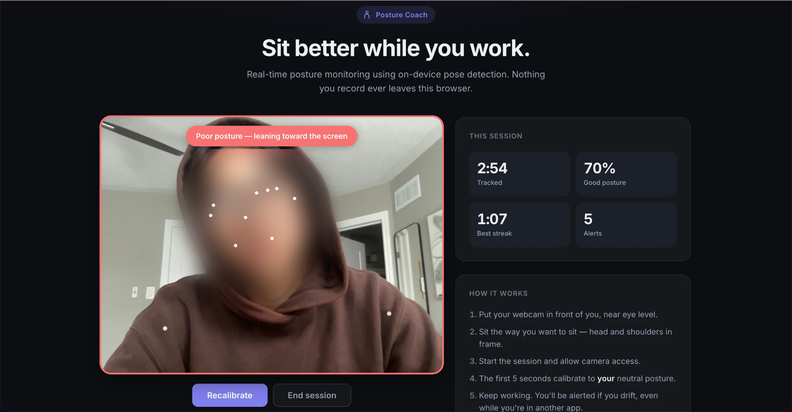
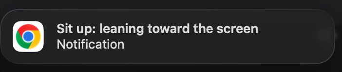
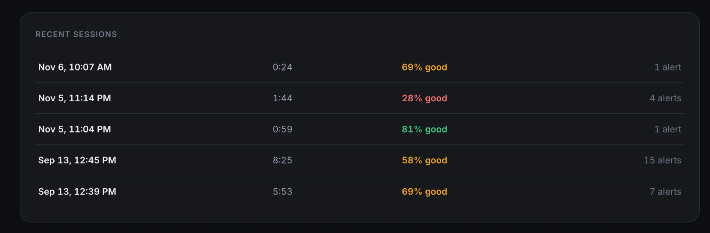

# Ergonomic Posture Coach

A posture coach that watches you through your webcam while you work and tells you exactly what's wrong: leaning toward the screen, head down, head jutting forward, or leaning to one side. Everything runs in your browser. No video is uploaded or stored.

**Live demo:** https://shanzayc.github.io/ergonomic-posture-coach/



## What makes it different

- **Uses what a front-facing camera can actually see.** A laptop webcam can't see you from the side, so instead of side-view angles it watches for signs it *can* see: your shoulders getting wider in the frame when you lean in, and your face getting larger relative to your shoulders when your head juts forward.
- **Limits picked from recorded data, not guesses.** A built-in tuning mode records what each signal does while you hold specific postures. The current limits came from those recordings (see [Tuning from real data](#tuning-from-real-data)).
- **Tells a head turn from a slouch.** Glancing at a second monitor shifts your head sideways, just like leaning on an elbow. The app tells them apart by face width and doesn't alert on head turns.
- **Calibrated to you.** It learns your neutral posture at the start of each session and only flags changes that are worse than that.
- **Alerts that reach you.** A desktop notification like "Sit up: leaning toward the screen" and an optional chime, even while you're working in another app.

  

Also includes session stats (time tracked, % good posture, best streak, alerts), a history of your last 10 sessions, and smoothing so normal jitter doesn't trigger false alarms.



## How to use

1. Put your webcam in front of you, near eye level, with your head and shoulders in frame.
2. Click **Start session** and allow camera access. Allow notifications too if you want alerts while you're in other apps.
3. Sit the way you want to sit for the first 5 seconds while it calibrates. Everything afterwards is measured against this.
4. Keep working. Hold a bad posture for about 4 seconds and you'll get an alert saying what's wrong.
5. Shifted position? Click **Recalibrate**. Done? Click **End session**: the camera turns off and the session is saved.

## How it works

[MediaPipe BlazePose](https://google.github.io/mediapipe/) finds 33 body points in each webcam frame (about 18 frames a second on a MacBook Air). From your shoulders, nose, eyes and ears, the app runs six checks against your calibrated baseline:

| Check | What it looks at | Fires when |
|---|---|---|
| Leaning toward the screen | Shoulder width in the frame | 20%+ wider than baseline |
| Head down | How far your nose sits below your shoulders | 0.18+ lower than baseline |
| Head jutting forward | Face width ÷ shoulder width | 12%+ larger than baseline |
| Leaning to one side | How far your head sits off-center | 0.15+ further off-center (skipped while your head is turned) |
| Shoulders uneven | Height difference between your shoulders | 0.12+ more than baseline |
| Slumped back in the chair | Shoulder width and head drop | 15%+ narrower (sank away from the camera) while the head sits 0.03+ lower |

When several checks fire at once, the alert names the cause rather than a side effect. For example, leaning in also makes your face look bigger, so it says "leaning toward the screen" rather than "head jutting forward."

Readings are smoothed over about half a second. An alert fires after a bad posture lasts 4 seconds, and posture has to look good for a full second before that timer resets.

## Accuracy

Measured with the built-in accuracy test in two runs of labeled trials. Each posture was held naturally for 7 seconds, with a fresh calibration each round, and both rule sets were scored from the same recorded frames. The rules were fixed before each run started.

### Run 2: current rules on fresh trials

55 trials over 5 rounds, recorded after every change below was made.

| Posture | Original rules | Current rules |
|---|---|---|
| Lean toward screen | 4/5 | **5/5** |
| Slump down | 1/5 | **5/5** |
| Chin forward | 0/5 | **5/5** |
| Lean on one elbow | 3/5 | **5/5** |
| Look down at keyboard | 5/5 | **5/5** |
| **Bad postures caught** | **52%** (13/25) | **100%** (25/25) |
| Good posture | 0/5 | 0/5 |
| Look at other monitor | 0/5 | 0/5 |
| Reach for a mug | 0/5 | 0/5 |
| Glance down at keyboard | 0/5 | 0/5 |
| Shift in your chair | 0/5 | 1/5 |
| Stretch | 0/5 | 4/5 |
| **False alarm rate** | **0%** (0/30) | **17%** (5/30) |
| **Named the right problem** | — | **68%** (17/25) |

- **Every bad posture was caught,** including slumping (5/5), which the earlier rules nearly always missed.
- **Stretching is the main source of false alarms (4 of 5).** A stretch held for several seconds looks like bad posture to the camera: one shoulder up, leaning back, head to one side. Normal movements like reaching for a mug or glancing at the keyboard caused none.
- **Leaning toward the screen was always caught but named "head down"** (0/5 named right), because the tester dropped their head while leaning in, and "head down" ranks first so looking at the keyboard is named correctly.
- The original rules had no false alarms mostly because they caught so little.

### Run 1: what led to the changes

70 trials over 10 rounds, before the slumped-back check and the naming order were added. The tuned rules caught **70%** of bad postures (35/50), up from **34%** (17/50) with the original rules, with 1 false alarm in 20 okay postures. Smoothing alone accounted for 34% → 42%.

The misses pointed to the changes. In 7 of 10 slump trials the tester sank back *away* from the camera (shoulders 19–37% narrower), which nothing checked for: slump was caught 1/10. And alerts named the right problem only 43% of the time, because the first matching check in a fixed list was named, and leaning in often triggered other checks too. Run 2 tested the fixes on new trials.

<details>
<summary>Run 1 per-posture results</summary>

| Posture | Original rules | Tuned rules |
|---|---|---|
| Lean toward screen | 2/10 | 10/10 |
| Lean on one elbow | 4/10 | 10/10 |
| Look down at keyboard | 8/10 | 9/10 |
| Chin forward | 1/10 | 5/10 |
| Slump down | 2/10 | 1/10 |
| Good posture (false alarms) | 0/10 | 0/10 |
| Look at other monitor (false alarms) | 0/10 | 1/10 |

</details>

All 125 trials were by one person (the developer), so other bodies and setups may differ, and 25 bad-posture trials is a small sample. Scores were cross-checked with an independent re-implementation of the scoring in Python. The app runs at about **18 frames per second** on a MacBook Air.

## Tuning from real data

The first version measured your nose sliding left or right of your shoulders and called it "head forward." Recording real postures showed that was the wrong signal:

| Posture | Shoulder width | Face size | Head drop | Head sideways |
|---|---|---|---|---|
| Good posture | +1% | −1% | −0.01 | −0.01 |
| Lean toward screen | **+28%** | **+23%** | **+0.20** | −0.03 |
| Look at other monitor | +2% | **−35%** | −0.07 | **+0.195** |
| Lean on one elbow | +9% | **+29%** | +0.13 | **+0.215** |
| Look down at keyboard | +4% | **+45%** | **+0.52** | −0.01 |

*Change from the calibrated baseline, one recording per posture.*

- **Leaning in** showed up clearly in shoulder width (+28%) but barely moved the old "head forward" signal.
- **Looking at another monitor** came within 0.025 of the old rule's 0.22 limit, a false alarm waiting to happen, while **leaning on an elbow** stayed just under it and was never flagged.
- **Face width separates the two:** it shrinks when you turn your head (−35%) and grows when you lean (+29%), so the sideways check now skips frames where your head is turned.

A second recording showed exaggerated slumping and chin-forward being caught (head drop +0.28, face size +16%), and normal shifting in the chair reaching +12% shoulder width, so the lean-in limit was set to 20%.

### Tune it for your setup

Add `?debug` to the URL (for example `https://shanzayc.github.io/ergonomic-posture-coach/?debug`) to open a tuning panel. It shows every reading live next to your baseline, records a 3-second average while you hold each of seven postures, and gives you the results as text to copy.

The same page has an **accuracy test**: it walks you through rounds of labeled trials (hold each posture for 7 seconds), saves every frame, and replays them through the app's real alert logic to report detection rate, false-alarm rate, and how often the alert named the right problem. It covers 5 bad postures and 6 normal movements (like reaching for a mug or stretching), scores the original rules and the current ones side by side from the same trials, keeps each test run separate, and lets you download the raw data.

<details>
<summary>Settings in <code>postureCoach.js</code></summary>

```javascript
const config = {
  autoCalibrateSeconds: 5,   // Calibration duration
  sustainedBadSeconds: 4,    // How long a bad posture lasts before an alert
  leanInThresh: 0.2,         // Shoulders 20% wider in frame = leaning toward the screen
  headDropThresh: 0.18,      // Head sinking toward the shoulders
  headForwardThresh: 0.12,   // Face 12% larger relative to shoulders = head jutting forward
  headSidewaysThresh: 0.15,  // Head further off-center (ignored while the head is turned)
  shoulderTiltThresh: 0.12,  // Shoulders more uneven than baseline
  slumpBackThresh: 0.15,     // Shoulders 15% narrower = sank back away from the camera...
  slumpDropMin: 0.03,        // ...while the head sits at least this much lower
  headTurnThresh: 0.15,      // Face 15% narrower = head turned
};
```

</details>

## Running locally

You need a webcam and an internet connection (the pose model loads from a CDN). Developed and tested in Chrome.

```bash
git clone https://github.com/shanzayc/ergonomic-posture-coach.git
cd ergonomic-posture-coach
python3 -m http.server 8000
```

Then open http://localhost:8000. Browsers only allow camera access on `https://` or `localhost`, so opening `index.html` directly from your files may not work.

| File | Purpose |
|---|---|
| `index.html`, `style.css` | Page layout and styling |
| `postureCoach.js` | Signals, calibration, posture checks, alerts, stats and history |
| `postureTracking.js` | Camera and pose-detection wrapper |
| `debugPanel.js` | The `?debug` tuning panel |
| `evaluator.js` | The `?debug` accuracy test |

The live demo is served by GitHub Pages from the `gh-pages` branch.

## Privacy

Pose detection runs in your browser, and video frames are never uploaded or saved. Session history stays in your browser's local storage. There are no accounts, server or analytics; the page only loads its scripts, pose model and font from public CDNs (jsDelivr and Google Fonts).

## Limitations

- **Stretching can trigger an alert.** A stretch held for 4+ seconds looks like bad posture (4 of 5 stretches alerted in testing). The "shoulders uneven" check is a likely place to start: it was the only check behind 2 of the 5 false alarms and never caught a bad posture by itself.
- **Leaning in is often named "head down."** The alert fires, but when you drop your head as you lean in, it names the head drop.
- **Subtle slouching is harder to see.** Testing used natural but clear postures. A very slight slump or chin-forward barely changes what a front-facing camera sees.
- **Limits come from one person's recordings.** Different cameras, desks and bodies may need different limits. Use `?debug` to check yours.
- **Calibration matters.** If you're slouching during the first 5 seconds, that becomes your baseline. Recalibrate if that happens.
- **Background alerts may slow down.** Browsers throttle hidden tabs, which can delay alerts if the tab stays hidden for a long time.

## Future enhancements

- [ ] Settings panel for alert sensitivity
- [ ] Break reminders (e.g. stand up every 30 minutes)
- [ ] Chart of posture over past sessions
- [ ] Export posture reports
- [ ] Multiple calibration profiles

## Acknowledgments

- [MediaPipe](https://google.github.io/mediapipe/) by Google for the BlazePose model
- [TensorFlow.js pose-detection](https://github.com/tensorflow/tfjs-models/tree/master/pose-detection) for the browser pose API

## Contact

- **GitHub:** https://github.com/shanzayc
- **LinkedIn:** https://www.linkedin.com/in/shanzaychaudhry/
- **Email:** shanzayc@outlook.com
